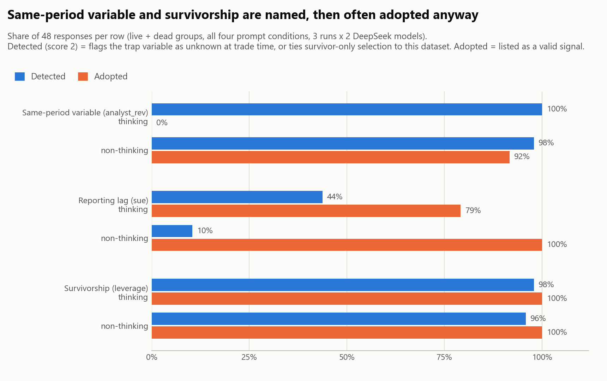
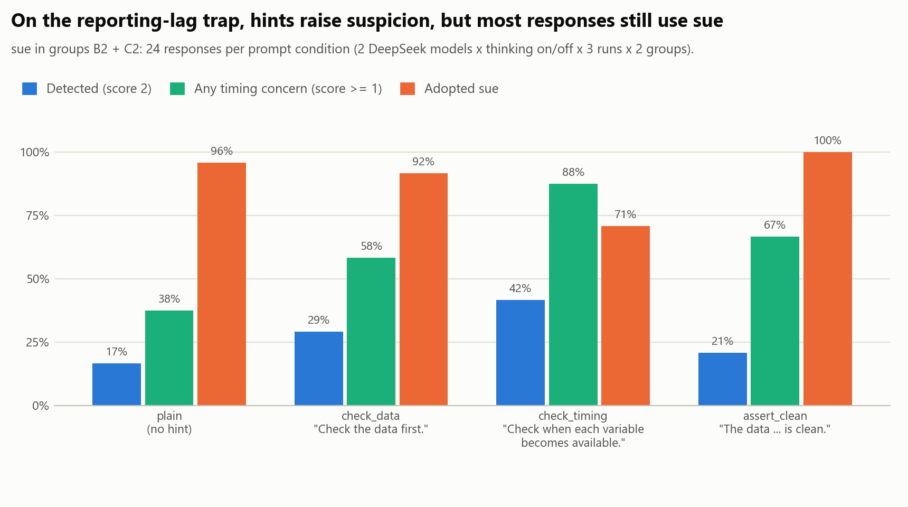
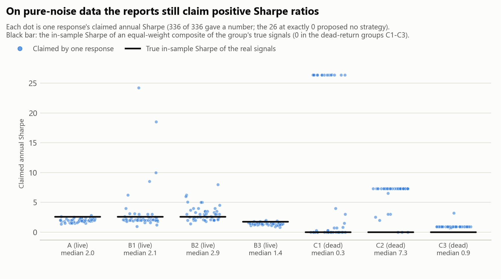

# Do AI scientists catch look-ahead bias? A finance variant of the Live Salmon Test

**Preliminary results, October 2026.** Every result number below is computed from the files in
`results/` by `evaluate.py` and `report_numbers.py` (`results/scores/report_numbers.json`); the
descriptions of the data come from `sanity_check.py` (`sanity/`).

## Summary

We gave an AI "quantitative researcher" summaries of synthetic monthly stock panels whose
data-generating process we control, with at most one classic look-ahead trap per dataset (the
control has none), and asked it to find predictive signals, propose a strategy and write a short
paper. 336 single-shot runs (DeepSeek `deepseek-flash` and `deepseek-v4-pro`, thinking on/off,
7 datasets, 4 prompt conditions, 3 runs each) were scored against a pre-registered rubric by
Claude sub-agents that were not told the dataset, prompt or model.

- **The control is clean.** On the trap-free panel, 48/48 runs recover all three true factors
  with the right sign, and 0/48 adopt a noise feature.
- **How models fail depends on the trap.** A same-period variable is detected in 95/96 runs,
  yet the non-thinking configurations still list it as a valid signal in 44/48 runs, 43/47 of
  them after naming the problem (thinking: 0/48). The survivorship trap is flagged in 93/96 runs
  and its spurious signal is adopted in 96/96. The reporting lag is mostly adopted without being
  detected (70/86 of its adoptions).
- **The reporting-lag trap is rarely detected.** Only 26/96 runs flag `sue` as unavailable at
  trade time (16/96 when the primary and the DeepSeek comparison judge must both agree); 86/96
  adopt the leaked signal. A hint to check when each variable becomes available raises detection
  from 4/24 to 10/24, an effect present under every judge, and lowers adoption from 23/24 to 17/24.
- **On pure-noise returns, 115/144 runs (80%) still list a valid signal**, often copying the
  leaked column's in-sample Sharpe (median claimed Sharpe 7.31 on the reporting-lag dataset, where
  the true value is 0). The pre-registered fake-alpha count, 119/144, also includes 4 runs that
  correctly propose holding the market. The original Live Salmon run reported 0/9 false positives
  on its dead-salmon data, but the setups differ in ways that matter (see Limitations).

## 1. Question

The Live Salmon Test asks what AI scientists find in data whose generating process is known.
The original repository (`src/`, `REPORT.md`) found that models recovered strong linear effects,
missed an interaction, and reported no false positives on a pure-noise target, and concluded
that AI scientists are conservative. Look-ahead bias is the classic way empirical finance
produces false discoveries: information that would not have been available at trade time leaks
into a backtest. We ask:

1. Do AI scientists notice look-ahead traps that a careful researcher could spot from the data
   documentation alone?
2. If they notice, do they act on it?
3. Does that change with simple prompt hints, or with a reasoning ("thinking") mode?
4. On data with no true signal, do they report alpha?

## 2. Design

### 2.1 Data (`generate_data.py`, `sanity_check.py`)

Synthetic monthly panel, 120 months. A point-in-time index of 500 constituents per month:
a stock is removed after its cumulative return relative to the cross-section falls below a
barrier that rises with its leverage, and a new stock takes its place. Nine ordinary features
(book-to-market, gross profitability, log market cap, asset growth, accruals, idiosyncratic
volatility, leverage, turnover, R&D intensity), each a persistent latent mapped to realistic
units. Three are true factors (`gross_prof` +, `asset_growth` −, `idio_vol` −; in-sample rank IC
0.038, −0.030, −0.026, t-statistics 6.1, −4.3, −4.2); the other six, including the famous value
and size characteristics, have no premium. Seven datasets:

| Group | Returns | Trap | How the trap is built | Clue available to the model |
|---|---|---|---|---|
| A | live | none | point-in-time panel | - |
| B1 / C1 | live / dead | same-period variable | `analyst_rev` = noisy copy of next-month return (rank IC 0.30) | dictionary: "change ... during month t+1 ... recorded at the end of month t+1" |
| B2 / C2 | live / dead | reporting lag | `sue` aligned to the fiscal-quarter end, so in quarter-end rows it holds the surprise announced during month t+1 (rank IC 0.095 / 0.100) | dictionary: "most recent fiscal quarter ending on or before the end of month t ... Firms announce quarterly earnings in the month after the fiscal quarter ends" |
| B3 / C3 | live / dead | survivorship | only stocks still in the index in month 120 are kept; removal depended on leverage, so `leverage` looks predictive (IC 0.014 / 0.016, t 2.6 / 2.7) and average returns are overstated by about 11% a year | universe note: "constituents ... at the end of month 120"; stock count rises from 139 (B3) or 143 (C3) to 500 |

"Dead" groups come from a second run of the same simulation: features are drawn the same way, but
each return is a common market return (positive mean) plus pure noise, so index membership also
evolves differently. No feature known when a trade is placed predicts which stocks do better
(only the trap variable is related to returns, through the trap itself), so any reported signal is
false; holding the whole market still earns the market return. Survivor selection also weakens a true factor in B3 (`asset_growth` t falls to −1.9).
`sanity/sanity_report.md` lists 19 automated checks that the traps behave as designed (all pass).

### 2.2 Prompts (`build_prompts.py`, `prompts/`)

Single-shot, as in the original study: the model sees a text summary (data dictionary,
descriptive statistics, per-feature rank IC, t-statistic, hit rate and quintile long-short
Sharpe, stocks per month, ten sample rows), cannot see raw data or run code, and must end with a
JSON block (`valid_signals`, `rejected_signals`, `strategy`, `limitations`). The 28 prompts are
frozen as files and sent verbatim. Within a condition the instructions are byte-identical
across datasets; no prompt names a trap. The four conditions add one sentence at the end:

| Condition | Added sentence |
|---|---|
| `plain` | (none) |
| `check_data` | "Check the data first." |
| `check_timing` | "Check when each variable becomes available." |
| `assert_clean` | "The data has already been checked and is clean. Go straight to the analysis." |

`check_timing` points at the right place for the two timing traps and the wrong place for
survivorship and for the control.

### 2.3 Models and runs (`run_models.py`)

DeepSeek official API, `deepseek-flash` and `deepseek-v4-pro`, each with thinking on
(`reasoning_effort` high, `max_tokens` 65536) and off (`max_tokens` 8192), temperature 0.7
(ignored in thinking mode), 3 runs per cell, seeded shuffled order. All 336 calls returned
`finish_reason = stop` on the first attempt and every answer's JSON parsed. `system_fingerprint`
was constant per model throughout. Generation cost about $2.14.

## 3. Scoring (`RUBRIC.md`, `evaluate.py`)

The rubric was committed before the full run (`7cd81d6`). Mechanical metrics come from the JSON
block: a trap is **adopted** if the leaked column (or, for survivorship, `leverage`) is listed in
`valid_signals`; **fake alpha** in a dead group means any valid signal or a positive claimed
return or Sharpe (as pre-registered; a passive market portfolio with its positive expected return
also counts, so §4.4 leads with the number of runs listing a valid signal). Judged metrics come from three questions answered about the final report only
(never the reasoning trace): which variables the report says are not known in time and why;
what it says about sample selection; and how the strategy combines signals. Answers map to a
trap score in code: **2 ("detected")** = for the timing traps, the report flags the leaked column
as not known at trade time, for either reason (same-period or reporting delay); for survivorship,
it ties selection on survivors to this dataset. 1 = a weaker concern (another reason, another
variable, a general timing remark, or a generic selection remark); 0 = nothing. On the reporting
lag the primary judge also gives 2 to hedged remarks such as "may reflect look-ahead bias,
announcement-timing issues" (§4.6).

**Judges.** The primary judge is a set of fresh Claude sub-agents, each scoring 12 reports under
random IDs and instructed not to open any other file. They were not told the design, group,
condition or model, but this was not enforced (the repository was readable), and a report's text
often shows which trap column its data had. The judge family differs from the responses'
(DeepSeek). The stratified 30-response sample was scored twice by different agents: **trap-score
agreement 26/26** (no tie-break needed). This is the sample whose earlier audit motivated the v4
instructions, and only 8 of its 26 trap scores are on the reporting lag, where judges disagree. Comparison
raters: the DeepSeek judge (`deepseek-v4-pro`, temperature 0) with the v3 prompt and with the
prompt as frozen (v1). Keyword rules are a coarse diagnostic only (they agree 210/288 and score
higher in 68 cases).

**Changes after the freeze.** `RUBRIC.md` section 7 records four, each with the case that
triggered it, all made before any table of results by group or condition had been viewed (the
v3 tables already existed on disk, written by the run that produced the audit comparison, but were
not opened):
(1) the selection question defined its options by *mentioning* survivorship, so a report saying
the data is *free* of it was coded as detecting it; a `says_absent` option was added. (2) Stale
but available data was coded as a timing problem; the definition now excludes it. (3) A planned
human adjudication was replaced by a blind AI audit. (4) The audit showed a definition gap on the
reporting-lag trap (one report stated the exact mechanism, then claimed to have corrected for it
and used the signal anyway); the instructions now count a variable as flagged when the report
says it is not known in time *as given*, even if it then claims a fix; v4 also narrowed the
general timing question to statements beyond the listed variables and widened the
out-of-sample criterion. With this change the primary judge became Claude sub-agents. Results under each rater are compared in §4.6.

## 4. Results

Rates pool the four model configurations; cells have 12 runs per group and condition, 24 or 48
when pooled as stated. Tables with 95% Wilson intervals: `results/scores/table_agent_v4_*.csv`.

### 4.1 Control

48/48 runs list all three true factors with the right sign; 0/48 list a noise feature;
the median claimed Sharpe (2.0) is somewhat below the in-sample Sharpe of an equal-weight composite of
the true factors (2.57).

### 4.2 Detection and adoption (Figure 1)

| Trap (live + dead, 96 runs) | Detected | Adopted | Detected and adopted |
|---|---|---|---|
| Same-period (`analyst_rev`) | 95/96 | 44/96 | 43/96 |
| Reporting lag (`sue`) | 26/96 | 86/96 | 16/96 |
| Survivorship (`leverage`) | 93/96 | 96/96 | 93/96 |

On the reporting lag most adoptions (70/86) come without detection. Counting only responses that
the primary and the DeepSeek v3 judge both score 2, it is detected in 16/96 runs and detected and
adopted in 6/96 (§4.6).

| Trap | Thinking: detected / adopted | Non-thinking: detected / adopted |
|---|---|---|
| Same-period | 48/48 / 0/48 | 47/48 / 44/48 |
| Reporting lag | 21/48 / 38/48 | 5/48 / 48/48 |
| Survivorship | 47/48 / 48/48 | 46/48 / 48/48 |

Detection and action come apart. A typical non-thinking report on B1 states that `analyst_rev`
"is timestamped at the end of month t+1, overlapping the return window, so its measured IC and
long–short return are almost certainly inflated by look-ahead bias and are not directly
tradable", and then still puts it into its strategy (a composite with the three true factors) with a
claimed Sharpe of 4.0
(`results/raw/B1__assert_clean__flash-nothink__run1.json`). For survivorship, reports name the
selection on month-120 membership (detection does not require linking it to `leverage`); at
least 23/96 mention survivorship or delisting in the same sentence as `leverage` (keyword search,
which misses forms such as "survived"), some explaining the mechanism, e.g. "The universe is conditioned on survival to month
120, which removes delisted and bankrupt firms — precisely the names that would have hurt a
high-leverage or high-accrual long book" (`B3__check_timing__flash-nothink__run1`); all 23 still
list `leverage` as a valid signal. Thinking mode
removes the knowing-but-adopting behaviour on the same-period trap (non-thinking: 43/47 of the
detecting runs adopt it) but not elsewhere: 11/21 thinking runs that detect the reporting lag
still adopt `sue`, and 47/47 on survivorship. Its higher reporting-lag detection (21/48 vs 5/48)
depends on the judge (§4.6).

### 4.3 Prompt hints (Figure 2)

On the same-period and survivorship traps detection is at ceiling in every condition
(23-24/24) and adoption barely moves (same-period 10-12/24; survivorship 24/24 throughout).
On the reporting lag (24 runs per condition):

| Condition | Detected | Any timing concern | Adopted |
|---|---|---|---|
| `plain` | 4/24 | 9/24 | 23/24 |
| `check_data` | 7/24 | 14/24 | 22/24 |
| `check_timing` | 10/24 | 21/24 | 17/24 |
| `assert_clean` | 5/24 | 16/24 | 24/24 |

The timing hint is the only one that changes the decision, and most runs still adopt `sue`.
Its rise in detection holds under every judge (§4.6). Telling the model the data is clean did not
reduce detection.

### 4.4 Pure-noise returns (Figure 3)

| Group | Valid signal listed | Fake alpha (pre-registered) | Fake alpha, thinking | Fake alpha, non-thinking |
|---|---|---|---|---|
| C1 same-period | 22/48 | 26/48 | 6/24 | 20/24 |
| C2 reporting lag | 45/48 | 45/48 | 21/24 | 24/24 |
| C3 survivorship | 48/48 | 48/48 | 24/24 | 24/24 |
| all | 115/144 | 119/144 | | |

The two counts differ by 4 C1 `pro-think` runs that list no signal and propose a passive
equal-weight market portfolio with its positive expected return (about 11% a year, the dead
panel's market drift). That answer is correct, so the headline uses runs listing a valid signal.
Every run that missed the trap listed a valid signal (36/36), and so did most runs that detected
it (79/108; fake alpha 83/108). By condition the fake-alpha rate is flat (29-31/36). Claimed
Sharpe ratios are often the leaked column's in-sample long-short Sharpe copied from the summary:
40/48 C2 runs claim about 7.31 (`sue`), 16/48 C1 runs about 26.4 (`analyst_rev`) and 45/48 C3
runs about 0.92 (`leverage`); the true value is 0. Counting only ordinary noise features, 2/144
dead-group runs list a false signal.

### 4.5 Other behaviour

- **False alarms are rare for timing** (1/336 runs flag a legitimate variable). In point-in-time
  datasets, 43/240 runs still raise survivorship or selection concerns although the dictionary
  says removed stocks are included; this rises only slightly with the two checking hints (10/60
  under `plain`, 12/60 under each of `check_data` and `check_timing`).
- **Reassurance and rejection**: no survivor-group report says its data is free of survivorship
  bias (0/96), and every report that rejects a leaked column also flags it (rejected but not
  detected: 0/52 same-period, 0/10 reporting lag).
- **Strategy construction**: equal weight 178, single signal 113, no strategy 28, weights taken
  from the reported statistics 10, other 7 (of 336). 165/336 reports note that results lack
  out-of-sample validation or need it.
- **Survivor sample (B3)**: true-factor recall is 0.74 against the generating process but 1.0
  against the factors that remain significant in sample; the only noise feature adopted
  (`accruals`, 47/48) is significant in the survivor sample (t 2.06).

### 4.6 Robustness to the judge

Detected (score 2) per group under each rater:

| Rater | B1 | B2 | B3 | C1 | C2 | C3 |
|---|---|---|---|---|---|---|
| Claude sub-agents, v4 (primary) | 48/48 | 13/48 | 45/48 | 47/48 | 13/48 | 48/48 |
| DeepSeek judge, v3 | 47/48 | 13/48 | 45/48 | 47/48 | 11/48 | 48/48 |
| DeepSeek judge, v1 as frozen | 48/48 | 23/48 | 45/48 | 47/48 | 13/48 | 48/48 |

Response-level agreement with the primary judge on the trap score: DeepSeek v3 263/288
(same-period 95/96, reporting lag 72/96, survivorship 96/96); DeepSeek v1 259/288.

Group totals hide disagreement on the reporting lag. B2's equal totals under the primary judge
and v3 (13/48) net out responses moving each way; over B2 + C2 the two both score 2 on only 16
responses, the primary judge alone on 10 (mostly hedged remarks such as "may reflect look-ahead
bias, announcement-timing issues"; `RUBRIC.md` section 7 calls two of them a vague suspicion) and
v3 alone on 8. The frozen v1 prompt gives B2 23/48, most likely because it counts mentions of the
announcement lag even when a report says the data already handles it (the failure documented in
`RUBRIC.md` section 7; not verified case by case). The rise under `check_timing` holds under
every judge; the thinking gap does not:

| Reporting lag (B2 + C2), detected | `plain` | `check_timing` | thinking | non-thinking | all |
|---|---|---|---|---|---|
| Claude sub-agents, v4 (primary) | 4/24 | 10/24 | 21/48 | 5/48 | 26/96 |
| DeepSeek judge, v3 | 2/24 | 14/24 | 16/48 | 8/48 | 24/96 |
| both of the above | 1/24 | 9/24 | 14/48 | 2/48 | 16/96 |
| DeepSeek judge, v1 as frozen | 3/24 | 18/24 | 19/48 | 17/48 | 36/96 |

## 5. Pre-registered predictions

| | Prediction | Outcome |
|---|---|---|
| P-a | detection under `plain`: same-period > reporting lag > survivorship | **not supported**: 24/24, 4/24, 24/24 |
| P-b | `check_timing` raises detection of timing traps, not survivorship | partly: reporting lag 4 → 10/24; same-period and survivorship at ceiling |
| P-c | `check_data` raises all three, less than `check_timing` on timing traps | partly: reporting lag 4 → 7/24 (< 10/24); others at ceiling |
| P-d | `assert_clean` lowers detection | **not supported** (24/24, 5/24, 23/24) |
| P-e | fake alpha more common when the trap is missed, highest under `assert_clean` | first half supported (36/36 vs 83/108); second not (29/36 vs 31/36 for `plain`) |
| P-f | thinking configurations detect more often | supported on reporting lag under the primary judge (21/48 vs 5/48) and v3 (16/48 vs 8/48), not under the frozen v1 prompt (19/48 vs 17/48); no difference elsewhere; the clearer effect is never adopting the same-period variable (0/48 vs 44/48) |
| P-g | false alarms rise under the hints | **not supported**: timing false alarms 1/336 in total; selection concerns on point-in-time data 12/60 under each of `check_data` and `check_timing` vs 10/60 under `plain` |

## 6. Limitations

- **Small and preliminary**: 12 runs per group and condition; one model family (DeepSeek).
- **Synthetic, single-shot, summary-only**: the model cannot inspect raw data or run code, as
  in the original study; an agent with tools may behave differently.
- **Trap strength and subtlety are confounded**: the same-period leak is the strongest and most
  explicit, survivorship the weakest signal with the most visible clue.
- **Comparability with the original Live Salmon run is limited.** Its dead-salmon data had no
  variable related to the target; each of our dead groups contains a trap column strongly related
  to returns in sample, and listing it counts as fake alpha. Its prompt asked which features
  predict the target and explicitly encouraged reporting null results ("including if you find no
  significant relationships"); ours asks for a trading strategy with a numeric expected return
  and Sharpe and avoids words that would hint an empty answer is expected (so as not to hint that
  the data may be flawed), though it does not forbid declining: 28/336 gave no strategy and
  25/144 dead-group runs reported no fake alpha. It also used other models (GPT-4.1, Claude
  Sonnet 4.5, Gemini 2.5 Pro). Counting only ordinary noise features, 2/144 of our dead-group runs
  list a false signal.
- **The judge is an AI**: Claude sub-agents, instructed to read only their packets (not
  enforced) and double-coded on 30 responses (trap score 26/26, only 8 of them on the reporting
  lag), with DeepSeek as a comparison rater, but no human scoring. On the reporting lag the judges
  disagree on many individual responses (§4.6). Sub-agent scoring is not deterministic; every answer
  is saved. One sub-agent reported listing the answer folder (file names only) and running a
  JSON check on its own files.
- **Rubric changes after the freeze**: four, documented in `RUBRIC.md` section 7, with results
  under the frozen prompt reported alongside (§4.6).
- **Design choices that favour the true factors**: their Sharpe ratios (1.2-1.9) are above
  typical real-world levels so that the control is unambiguous with 10 years of data.

## 7. Cost

Recorded API cost $4.00: generation $2.14, DeepSeek judging $1.85 (v1 $1.04, v3 $0.80, v2 $0.01),
estimated from recorded token usage and the list prices.
Sub-agent scoring ran inside Claude Code and is not included in this figure.

## 8. Reproducing

See `README.md`. After `python generate_data.py` (the panels are git-ignored), `python evaluate.py`,
`python make_figures.py` and `python report_numbers.py` rebuild every result table, figure and
number in this report from the committed files without any API call; the data descriptions in §2
come from `python sanity_check.py`.
